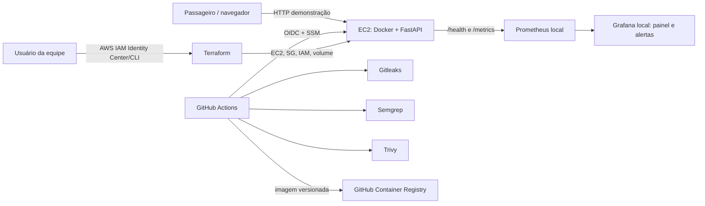

# Relatório técnico — Secure DevOps & Cloud Computing

## Ponto Falante | Deploy Blindado

**Global Solution 2026.2 · CitizenTech · Engenharia de Software 4º ano · Disciplina 6 de 7**  
**Integrantes e RMs:** Bryan Willian Messias Barbosa (551305); Felipe Terra (99405); Gabriel Doms (98630); Lucas Vassão (98607); Pedro Bicas (99534).  
**Repositório público:** [GS-Secure-DevOps-Tools-Cloud-Computing](https://github.com/FeTerra/GS-Secure-DevOps-Tools-Cloud-Computing) · **MVP publicado:** [PENDENTE após provisionamento]  
**Data da coleta de custos:** 16/11/2026 · **Status:** pipeline CI aprovado e imagem publicada no GHCR; deploy AWS e evidências de observabilidade/custo ainda pendentes.

## 1. Resumo

Este trabalho prepara uma entrega DevSecOps para o Ponto Falante, uma CitizenTech voltada à acessibilidade no transporte. A implementação inclui uma aplicação FastAPI com interface web, rotas de saúde/status/pontos/previsões, métricas Prometheus, container não-root, stack local Compose, dashboard provisionado no Grafana, regras de alerta, análise no GitHub Actions e infraestrutura AWS descrita em Terraform. A fonte de previsão desta implementação é fixa e didática; não há conexão SPTrans, autenticação de passageiros ou coleta de dados pessoais. O código e a infraestrutura estão prontos para execução, mas URL pública, saídas reais do pipeline, alerta disparado e custos observados dependem da execução na conta/repositório da equipe. Essas evidências não são simuladas neste relatório.

## 2. Arquitetura

Prometheus e Grafana são locais e devem apontar para a URL pública do MVP se for necessário observar a instância remota. As métricas da API medem requisições HTTP, duração, taxa de erro derivável por status e disponibilidade do alvo. A regra `MVPIndisponivel` dispara quando `up == 0`; `LatenciaElevada` alerta para p95 superior a 1 s sustentado por cinco minutos. Uma regra configurada não prova que um alerta foi disparado: anexar captura após provocar indisponibilidade controlada.

## 3. Segurança e responsabilidade compartilhada

| Camada | Controle implementado / responsabilidade |
|---|---|
| Aplicação/container | Dockerfile Python slim, UID não-root, health check; Compose em filesystem somente leitura, `/tmp` temporário, capabilities removidas e `no-new-privileges`. |
| Pipeline | Gitleaks, Semgrep, Trivy para CVEs HIGH/CRITICAL corrigíveis; workflow em push e pull request; bloqueio de build diante de achados configurados. |
| Segredos | `.env` ignorado para Grafana local; imagem não inclui credenciais; deploy usa OIDC e IAM temporário. Nunca registrar token real. |
| Nuvem | Security group permite HTTP/HTTPS e não tem SSH nem porta de administração; volume gp3 criptografado; IMDSv2 obrigatório; SSM para comando remoto. |
| Dados/LGPD | Nenhum dado pessoal é solicitado ou persistido. Sem usuário, rosto, localização, gravação de câmera ou conversa armazenada. Logs devem omitir conteúdo da conversa e identificadores. |
| Limite | A configuração EC2 de demonstração entrega HTTP e não instala certificado TLS. Não usar com dados pessoais/produção antes de configurar domínio, TLS, logs e revisão de segurança. |

State do Terraform pode conter metadados de recursos e não deve ser enviado ao Git. Para uso compartilhado, configure backend remoto criptografado e controle de acesso antes do primeiro `apply`.

## 4. Container e execução local

Com Docker Desktop instalado, copiar `.env.example` para `.env`, trocar a senha de Grafana, então executar `docker compose up --build -d`. Endpoints de demonstração: `http://localhost:8000`, Grafana em `http://localhost:3000` e Prometheus em `http://localhost:9090`. Grafana e Prometheus são vinculados a `127.0.0.1`. A API serve a interface, documenta a fonte simulada e expõe `/health`, `/api/status`, `/api/pontos`, `/api/pontos/{codigo}/previsoes` e `/metrics`.

**Evidência a inserir:** [captura real de `docker compose ps`] · [captura de `docker inspect` mostrando usuário não-root e portas] · [captura de `/health` e origem simulada na interface].

## 5. Pipeline de segurança e publicação

O workflow `.github/workflows/devsecops.yml` executa Gitleaks, Semgrep e build a cada push/PR; Trivy bloqueia achados CRITICAL/HIGH. No push para `main`, publica a imagem no GHCR, assume uma role AWS via OIDC e solicita atualização EC2 usando SSM. A confiança OIDC é limitada ao `owner/repo` e à branch `main`. É necessário configurar `AWS_DEPLOY_ROLE_ARN` como GitHub Secret, e `AWS_REGION`/`EC2_INSTANCE_ID` como variáveis do repositório. A role e a instância são criadas pelo Terraform.

O pull da imagem GHCR pela instância não autenticada exige tornar o pacote público, ou implementar login temporário com credenciais mínimas no host. A conta AWS também precisa ter o provider OIDC do GitHub ainda não registrado; se já existir, importar/adotar o recurso em vez de criar duplicata. A primeira imagem e infraestrutura precisam ser inicializadas antes de a etapa automática poder operar.

**Evidências do pipeline:** [execução anterior barrada pelo Trivy](https://github.com/FeTerra/GS-Secure-DevOps-Tools-Cloud-Computing/actions/runs/44000597597) · [execução corrigida: Gitleaks, Semgrep, Trivy e publicação GHCR aprovados](https://github.com/FeTerra/GS-Secure-DevOps-Tools-Cloud-Computing/actions/runs/44000873548). O deploy AWS foi ignorado porque as variáveis de ambiente do repositório e a infraestrutura ainda não foram configuradas. **Evidência ainda pendente:** deploy concluído e URL pública respondendo.

## 6. Infraestrutura como código

Terraform provisiona VPC, subnet pública, rota e Internet Gateway, Amazon Linux 2023, EC2 `t3.micro`, volume raiz gp3 de 20 GiB criptografado, security group sem SSH, perfil EC2 limitado ao SSM e role GitHub OIDC com permissão de envio de comando à instância tagged `Project=GlobalSolution`. O user-data instala Docker e inicia a imagem. Saída da infraestrutura: URL pública HTTP e ID da instância.

Comandos, após revisar região, imagem e repositório no `terraform.tfvars`: `terraform init`, `terraform plan`, revisar mudanças/custo e `terraform apply`. Após demonstração, `terraform destroy` encerra recursos. **Não execute `apply` sem revisar plano e credenciais da própria equipe.**

**Evidências a inserir:** [plan/apply] · [security group sem 22/3389 e sem porta de monitoramento pública] · [instância e URL funcionando].

## 7. Observabilidade

Dashboard deve apresentar quatro métricas de ouro: latência p95, taxa de erro HTTP, taxa/volume de requisições e disponibilidade. Configure painel no Grafana usando PromQL; regra de indisponibilidade e regra de latência estão em `monitoring/alerts.yml`. O alerta será considerado demonstrado somente quando houver evidência de estado disparado no Prometheus/Grafana.

**Evidências a inserir:** [dashboard de 4 métricas com dados da aplicação] · [alerta disparado e resolvido] · [Prometheus apontando para a URL publicada].

## 8. Estimativa de custo

Estimativa mensal de referência para 730 horas, uma EC2 `t3.micro`, 20 GB gp3 e um IPv4 público. Os preços base abaixo são referências públicas da AWS consultadas em 16/11/2026; região, impostos, franquia, tráfego e elegibilidade de Free Tier alteram a fatura. A página AWS de T3 lista US$ 0,0104/h para `t3.micro`; IPv4 em uso custa US$ 0,005/h; gp3 é US$ 0,08/GB-mês.

| Item | Conta ilustrativa | USD/mês |
|---|---:|---:|
| EC2 t3.micro | 730 h × US$ 0,0104 | 7,59 |
| IPv4 público | 730 h × US$ 0,005 | 3,65 |
| Volume gp3 de 20 GB | 20 × US$ 0,08 | 1,60 |
| **Subtotal de referência** | sem impostos, saída de dados, DNS, TLS pago ou monitoramento AWS | **12,84** |

Este subtotal usa preço de referência, não uma cotação garantida para sa-east-1. Antes do envio, substituir por estimativa da região escolhida no AWS Pricing Calculator e anexar captura ou fatura do Cost Explorer. Instância ligada depois da apresentação continua cobrando; destruir recursos ao concluir.

Fontes: [preços EC2 T3](https://aws.amazon.com/ec2/instance-types/t3/), [preços de IPv4 público](https://aws.amazon.com/vpc/pricing/), [preços EBS gp3](https://aws.amazon.com/ebs/general-purpose/).

## 9. Matriz de aderência à rubrica

| Critério do enunciado (14 pts) | Entrega preparada | Evidência que falta à equipe |
|---|---|---|
| Container e IaC (5,0) | Dockerfile, Compose, Terraform e controles de acesso | Execução real do Compose e apply na conta; atualizar domínio/TLS antes de produção. |
| Pipeline DevSecOps (4,0) | GitHub Actions com Gitleaks, Semgrep, Trivy, publicação GHCR e base de deploy OIDC/SSM | Runs de falha/correção já registrados; falta configurar OIDC/SSM para comprovar deploy automático. |
| Observabilidade (3,0) | Métricas e regras Prometheus, datasource Grafana | Painel de quatro métricas alimentado pelo MVP publicado e alerta realmente disparado. |
| Documentação (2,0) | Arquitetura, responsabilidade, LGPD, custo e README | Integrantes/RMs, links finais, URL, capturas e cotação real. |

## 10. Conclusão

A base de código implementa a cadeia necessária para demonstrar controles DevSecOps e mantém explícita a natureza simulada das previsões. O repositório e o pipeline já estão publicados; a submissão acadêmica ainda depende de provisionar e evidenciar o MVP, dashboard/alerta e custo na região escolhida. Nenhuma captura de nuvem ou observabilidade foi fabricada neste relatório.
