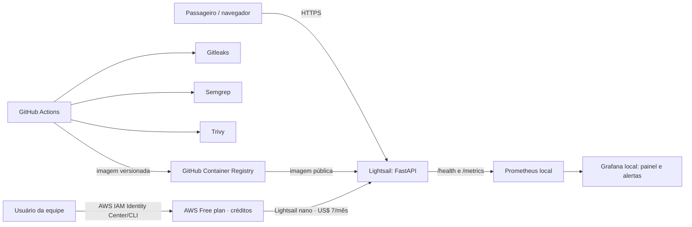

# Relatório técnico — Secure DevOps & Cloud Computing

## Ponto Falante | Deploy Blindado

**Global Solution 2026.2 · CitizenTech · Engenharia de Software 4º ano · Disciplina 6 de 7**  
**Integrantes e RMs:** Bryan Willian Messias Barbosa (551305); Felipe Terra (99405); Gabriel Doms (98630); Lucas Vassão (98607); Pedro Bicas (99534).  
**Repositório público:** [GS-Secure-DevOps-Tools-Cloud-Computing](https://github.com/FeTerra/GS-Secure-DevOps-Tools-Cloud-Computing) · **MVP publicado:** [Ponto Falante (HTTPS)](https://ponto-falante.y48raqk9mz0k0.us-east-2.cs.amazonlightsail.com/)  
**Coleta de evidências:** 17/11/2026 · **Status:** imagem GHCR pública, serviço Lightsail ativo e `/health` validado. O plano gratuito AWS está ativo com créditos promocionais; o Cost Explorer ainda não refletiu a criação de hoje. O alerta gerenciado não está disponível para métricas de containers Lightsail.

## 1. Resumo

O MVP FastAPI está publicado no Amazon Lightsail Container Service, em HTTPS, com imagem pública do GHCR. `/health` retorna `ok`; `/api/status` identifica explicitamente a fonte como simulador e informa que não há conexão SPTrans. Foram coletadas métricas reais de CPU/memória e respostas do Cost Explorer. O serviço usa o power nano (US$ 7/mês de preço de tabela); a conta está no AWS Free plan com créditos, sem ativação de plano pago. Como o Cost Explorer ainda exibe US$ 0 estimados apenas até 16/11, esse valor não representa o custo final do recurso criado em 17/11. O Lightsail Container Service não suporta alarmes/notificações para suas métricas, portanto não existe alerta real anexável nesse serviço. Evidências JSON estão em `docs/evidencias/aws-deploy-snapshot.json`.

## 2. Arquitetura

Prometheus e Grafana podem ser executados localmente, mas a evidência coletada na nuvem é do painel de métricas do serviço Lightsail. Na coleta real, CPU: média 3,27%, máximo 22,30%; memória: média 6,01%, máximo 7,23% (janela recente retornada pela API). A AWS confirma que alarmes e notificações não são suportados para métricas de container service. As regras Prometheus locais existentes não foram apresentadas como um alerta AWS real nem como disparadas.

## 3. Segurança e responsabilidade compartilhada

| Camada | Controle implementado / responsabilidade |
|---|---|
| Aplicação/container | Dockerfile Python slim, UID não-root, health check; Compose em filesystem somente leitura, `/tmp` temporário, capabilities removidas e `no-new-privileges`. |
| Pipeline | Gitleaks, Semgrep, Trivy para CVEs HIGH/CRITICAL corrigíveis; workflow em push e pull request; bloqueio de build diante de achados configurados. |
| Segredos | `.env` ignorado para Grafana local; imagem não inclui credenciais. Deploy AWS automático via OIDC está desativado pelo bloqueio da conta. Nunca registrar token real. |
| Nuvem (MVP implantado) | Lightsail Container Service nano, HTTPS público gerenciado, imagem GHCR pública, escala 1 e health check `/health`. Não há SSH exposto. A arquitetura EC2/Terraform é alternativa documentada e não foi implantada. |
| Dados/LGPD | Nenhum dado pessoal é solicitado ou persistido. Sem usuário, rosto, localização, gravação de câmera ou conversa armazenada. Logs devem omitir conteúdo da conversa e identificadores. |
| Limite | O MVP do Lightsail usa HTTPS gerenciado; a alternativa EC2/Terraform de demonstração entrega HTTP e não instala certificado TLS. A API é simulada e não serve para orientar viagem real. |

O Terraform EC2 permanece como código de referência; não foi aplicado nesta conta. State do Terraform pode conter metadados de recursos e não deve ser enviado ao Git.

## 4. Container e execução local

Com Docker Desktop instalado, copiar `.env.example` para `.env`, trocar a senha de Grafana, então executar `docker compose up --build -d`. Endpoints de demonstração: `http://localhost:8000`, Grafana em `http://localhost:3000` e Prometheus em `http://localhost:9090`. Grafana e Prometheus são vinculados a `127.0.0.1`. A API serve a interface, documenta a fonte simulada e expõe `/health`, `/api/status`, `/api/pontos`, `/api/pontos/{codigo}/previsoes` e `/metrics`.

A configuração e segurança local do container estão descritas no Dockerfile e Compose; a execução real documentada neste relatório é a imagem publicada no Lightsail. Respostas reais de `/health` e `/api/status` foram anexadas em `docs/evidencias/aws-deploy-snapshot.json`.

## 5. Pipeline de segurança e publicação

O workflow `.github/workflows/devsecops.yml` executa Gitleaks, Semgrep e build a cada push/PR; Trivy bloqueia achados CRITICAL/HIGH. No push para `main`, publica a imagem no GHCR. O deploy automático foi mantido desativado: a política gerenciada da conta AWS de projeto nega a criação de provedores IAM OIDC (`iam:*Provider*`), requisito do fluxo Terraform/GitHub. Habilitar recursos avançados exige migrar a conta para o plano pago, o que não foi feito. A publicação em produção desta entrega foi manual via sessão temporária local da equipe, sem chave AWS persistente no GitHub.

A imagem do GHCR está pública e foi consumida pelo Lightsail. As permissões da conta de projeto negaram a criação do provedor IAM OIDC exigido pela automação; não se habilitou o plano pago nem se gravaram credenciais AWS de longa duração como secrets do GitHub.

**Evidências do pipeline:** [execução anterior barrada pelo Trivy](https://github.com/FeTerra/GS-Secure-DevOps-Tools-Cloud-Computing/actions/runs/44000597597) · [execução corrigida: Gitleaks, Semgrep, Trivy e publicação GHCR aprovados](https://github.com/FeTerra/GS-Secure-DevOps-Tools-Cloud-Computing/actions/runs/44000873548). O job automático de deploy continua ignorado por não haver role OIDC elegível nessa conta. O MVP foi publicado manualmente no Lightsail e validado na URL acima; os detalhes e snapshots estão em `docs/evidencias/aws-deploy-snapshot.json`.

## 6. Infraestrutura como código

O Terraform do repositório descreve uma arquitetura EC2 com OIDC/SSM, mas ela não pôde ser aplicada nessa conta por bloqueio de SCP na criação do provider OIDC. Para entregar uma URL funcional sem ativar plano pago, o MVP foi publicado manualmente em um Lightsail Container Service `ponto-falante`, região `us-east-2`, power nano, escala 1, imagem GHCR pública, porta HTTP 8000 no container e health check `/health`. O endpoint público do Lightsail termina HTTPS automaticamente. O snapshot de estado está em `docs/evidencias/aws-deploy-snapshot.json`.

A infraestrutura EC2 descrita em `terraform/` não foi aplicada: a política AWS da conta de projeto bloqueia o provider OIDC e não fizemos upgrade para o plano pago. A implantação comprovada é o Lightsail descrito acima. **Não há evidência de `terraform plan/apply` nem de instância EC2.**

## 7. Observabilidade

O dashboard real do Lightsail fornece CPU e memória do serviço. Na coleta de 17/11/2026: CPU média 3,27% e pico 22,30%; memória média 6,01% e pico 7,23%. A aplicação também expõe `/metrics` para Prometheus local. O Lightsail Container Service não aceita alarmes ou notificações de CPU/memória; por isso não há alerta real nesse serviço. Não foi criada infraestrutura adicional de monitoramento que consuma créditos. Fonte: [documentação oficial de métricas de containers Lightsail](https://docs.aws.amazon.com/lightsail/latest/userguide/amazon-lightsail-viewing-container-services-metrics.html). A captura/saída estruturada da consulta está no snapshot JSON.

## 8. Estimativa de custo

O recurso publicado usa o plano Lightsail Container Service `nano`, cujo preço de tabela retornado pela API AWS é US$ 7/mês para 0,25 vCPU e 0,5 GB RAM. A conta AWS estava no plano gratuito com US$ 100 em créditos promocionais e 182 dias restantes na coleta; portanto, o recurso consome créditos do plano enquanto elegível, sem upgrade para plano pago. O saldo corrente deve ser confirmado em Billing & Cost Management. O Cost Explorer consultado em 17/11 retornou US$ 0 estimados por dia somente até 16/11; o lançamento do serviço no mesmo dia ainda não estava refletido. Esse snapshot defasado não prova custo final de US$ 0.

| Item | Referência | USD/mês |
|---|---:|---:|
| Lightsail Container Service nano | 1 nó, preço retornado pela API `get-container-service-powers` | 7,00 |
| Cost Explorer | Consulta diária; dados estimados/defasados até 16/11/2026 | 0,00 exibido (não inclui lançamento posterior) |
| **Custo recorrente de tabela** | Não inclui impostos/uso excedente; crédito promocional pode cobrir cobrança elegível | **7,00** |

Créditos promocionais reduzem desembolso enquanto disponíveis, mas não tornam a execução sem custo econômico. O snapshot real do Cost Explorer e do catálogo de preços está junto das evidências. O plano gratuito pode encerrar/fechar a conta no consumo dos créditos ou fim do prazo; não selecionar upgrade pago. O serviço permanece ativo e pode consumir créditos mês a mês.

Fonte: API AWS `lightsail get-container-service-powers` consultada em 17/11/2026; condições do plano/créditos em Billing & Cost Management. O Cost Explorer ainda não incorporava o recurso novo na coleta.

## 9. Matriz de aderência à rubrica

| Critério do enunciado (14 pts) | Entrega preparada | Evidência que falta à equipe |
|---|---|---|
| Container e IaC (5,0) | Dockerfile, Compose, Terraform e MVP ativo no Lightsail | Registro real de deploy via serviço gerenciado; não é evidência de `terraform apply` da arquitetura EC2. |
| Pipeline DevSecOps (4,0) | GitHub Actions com Gitleaks, Semgrep, Trivy e publicação GHCR | Deploy automático OIDC não habilitado por SCP da conta; publicação no Lightsail foi manual. |
| Observabilidade (3,0) | Métricas Lightsail reais de CPU/memória e endpoint `/metrics` | Alerta não suportado para métricas de container Lightsail; regra Prometheus local não está sendo alegada como alerta real. |
| Documentação (2,0) | Arquitetura, responsabilidade, LGPD, custo, URL e evidências JSON | Anexar captura visual do console se a rubrica exigir screenshots; Cost Explorer atualiza com atraso. |

## 10. Conclusão

O MVP está acessível em HTTPS e seu health check foi validado; CPU/memória reais foram coletados na AWS, e o relatório registra o preço de tabela e a leitura defasada do Cost Explorer. O deploy automático GitHub→AWS permaneceu desligado por bloqueio IAM/OIDC da conta gratuita, sem upgrade para plano pago. Também não há alarme real de container, pois o Lightsail não oferece essa função. O MVP é didático e suas previsões não vêm da SPTrans; deixe isso claro na apresentação. Os snapshots anexados são respostas reais da AWS e da API no horário indicado, não capturas de tela fabricadas.
